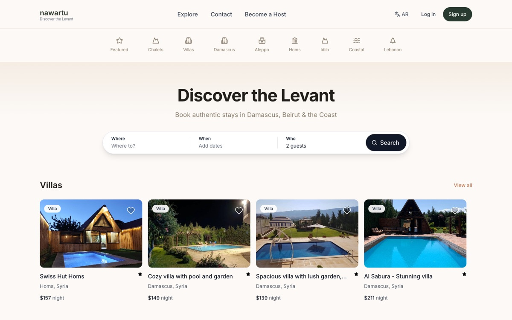

# Harb

**« Verso le Nuvole »** ☁️ &nbsp;·&nbsp; founder · builder · NYC

I build products **end to end** — the code, the launch,
and the marketing.

---

## Building now

<table>
<tr>
<td width="50%" valign="top">

  
🪺 <b><a href="https://nested.social">Nested</a></b> — project network for NYC students: post what you're building, find teammates. React + Supabase, 76 migrations, 117 tests. Live in soft launch. 
→ <a href="https://github.com/nestednyc/nested-nyc">repo</a> · <a href="https://instagram.com/nestedsocial">@nestedsocial</a>
</td>
<td width="50%" valign="top">

  
🏮 <b><a href="https://nawartu.com">Nawartu</a></b> — <i>"you lit the place up."</i> Book authentic stays across the Levant: web platform, mobile app, and the media that introduces the region. 8.3k on <a href="https://instagram.com/nawartuofficial">Instagram</a> · <a href="https://tiktok.com/@nawartu">TikTok</a>
</td>
</tr>
</table>

## Day job

Sole engineer @ **[Universal Cellular NYC](https://universalcellularnyc.com)** — built the internal platform end to end (1,300+ commits): inventory synced live to wholesale buyers' sheets, [Android fleet automation](https://github.com/maxgooose/Automating-White-Collar-Work), an RMA pipeline rebuilt around a locally-deployed AI, an HR ticketing portal, a NAS search assistant, the public site above, and an automated [device-grading rig](https://github.com/maxgooose/grading-station-mvp).

## Roots

🧩 **[Syrian Mosaic Foundation](https://syrianmosaicfoundation.org)** — co-founder. Website in 6 languages, event sign-up API, and media campaigns for ~10k followers. → [@SyrianMosaicFoundation](https://instagram.com/SyrianMosaicFoundation)

## Side builds

🔮 [ORB](https://github.com/maxgooose/orb) — a rolling robot that hears how you feel and answers with movement and light.

🖐️ [Tetris you play in the air](https://github.com/maxgooose/hand-tracking-ar) — hand tracking in the browser.

🫐 [Blueberry](https://github.com/maxgooose/Blueberry) — Excel/VBA inventory system for refurbished devices, wired to the WholeCell API.

## Off hours

✈️ 20+ countries and counting. I love travelling more than anything.

---

نوّرتوا — you lit the place up by stopping by.

