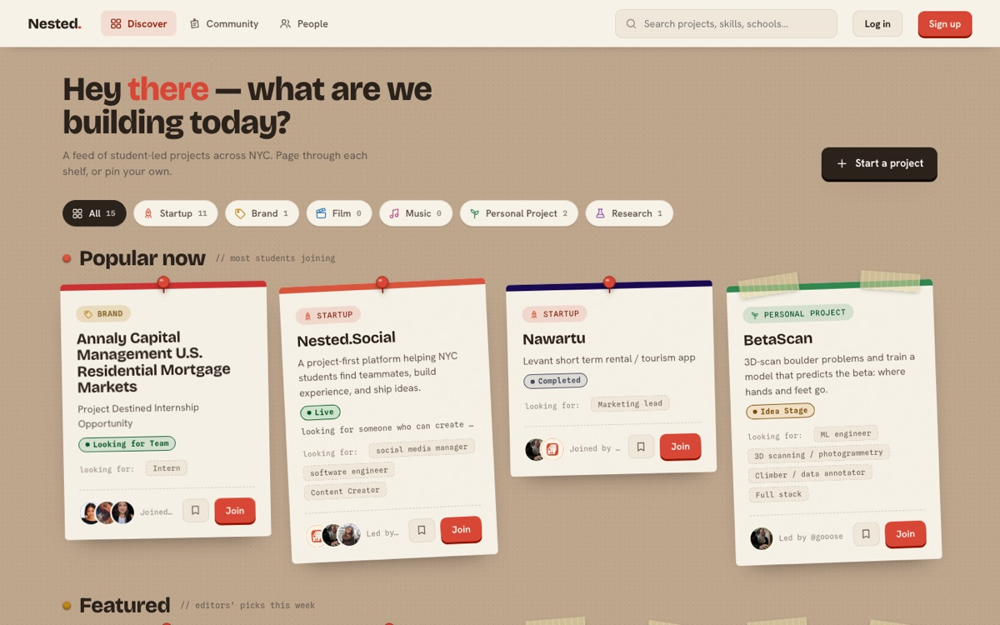
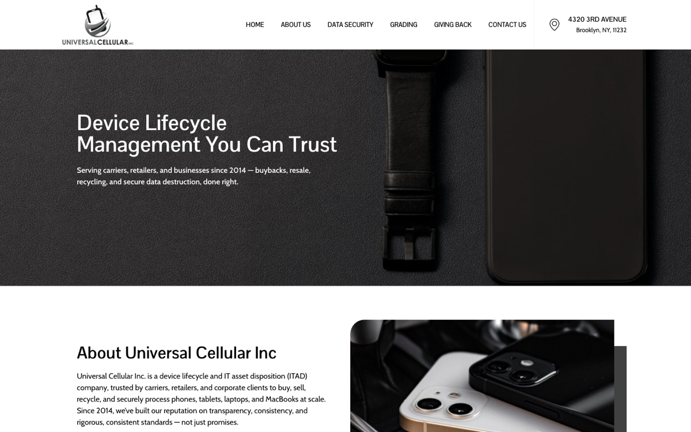
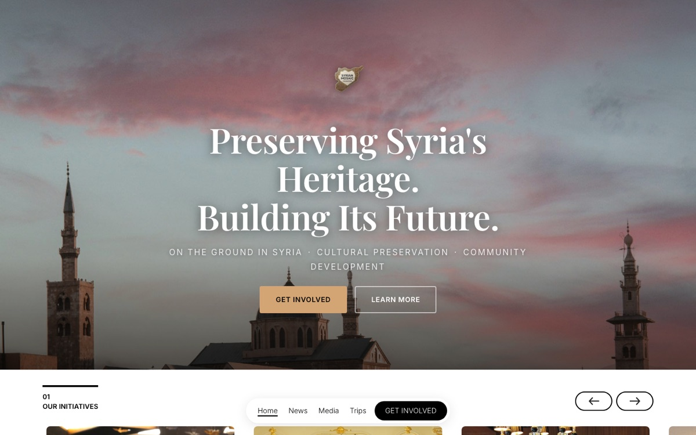

# Harb

**« Verso le Nuvole »** &nbsp;·&nbsp; founder · builder · NYC

I build products **end to end** — the code, the launch, and the marketing.

 

<table>
<tr>
<td width="50%" valign="top">

<h3><a href="https://nested.social">Nested</a></h3>
Project network for NYC students: post what you're building, find teammates. React + Supabase, 76 migrations, 117 tests. Live in soft launch.  
<a href="https://github.com/nestednyc/nested-nyc">Repo</a> · <a href="https://instagram.com/nestedsocial">Instagram</a>
</td>
<td width="50%" valign="top">

<h3><a href="https://nawartu.com">Nawartu</a></h3>
<i>"You lit the place up."</i> Book authentic stays across the Levant: web platform, mobile app, and the media that introduces the region. 8.3k on Instagram.  
<a href="https://instagram.com/nawartuofficial">Instagram</a> · <a href="https://tiktok.com/@nawartu">TikTok</a>
</td>
</tr>
<tr>
<td width="50%" valign="top">

<h3><a href="https://universalcellularnyc.com">Universal Cellular NYC</a></h3>
Sole engineer. Built the internal platform end to end (1,300+ commits): inventory synced live to wholesale buyers' sheets, Android fleet automation, an RMA pipeline rebuilt around a locally-deployed AI, an HR ticketing portal, a NAS search assistant, the public site, and an automated device-grading rig.  
<a href="https://github.com/maxgooose/Automating-White-Collar-Work">Fleet automation</a> · <a href="https://github.com/maxgooose/grading-station-mvp">Grading rig</a>
</td>
<td width="50%" valign="top">

<h3><a href="https://syrianmosaicfoundation.org">Syrian Mosaic Foundation</a></h3>
Co-founder. Website in 6 languages, event sign-up API, and media campaigns for ~10k followers.  
<a href="https://instagram.com/SyrianMosaicFoundation">Instagram</a>
</td>
</tr>
</table>

### Side builds

- [ORB](https://github.com/maxgooose/orb) — a rolling robot that hears how you feel and answers with movement and light.
- [Tetris you play in the air](https://github.com/maxgooose/hand-tracking-ar) — hand tracking in the browser.
- [Blueberry](https://github.com/maxgooose/Blueberry) — Excel/VBA inventory system for refurbished devices, wired to the WholeCell API.

### Off hours

20+ countries and counting. I love travelling more than anything.

 

نوّرتوا

You lit the place up by stopping by.

